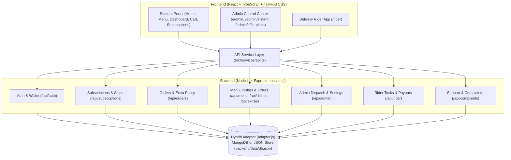
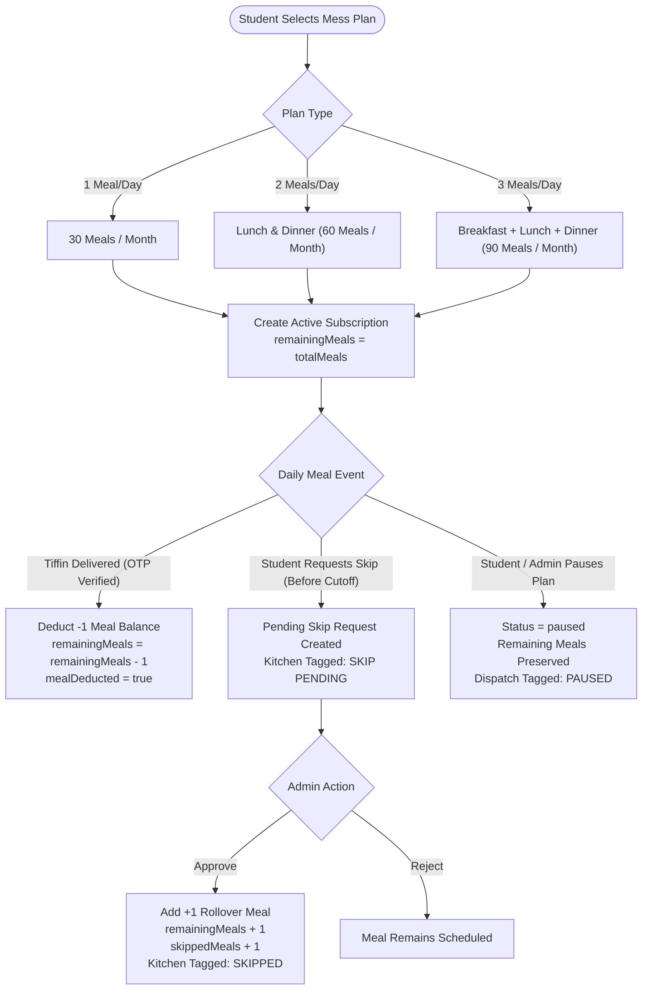
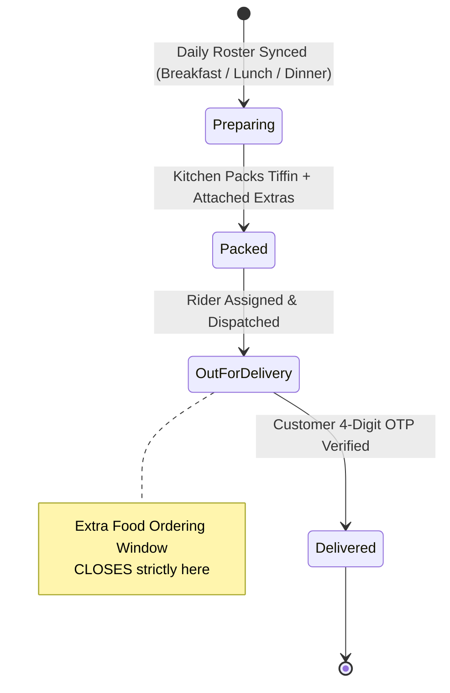
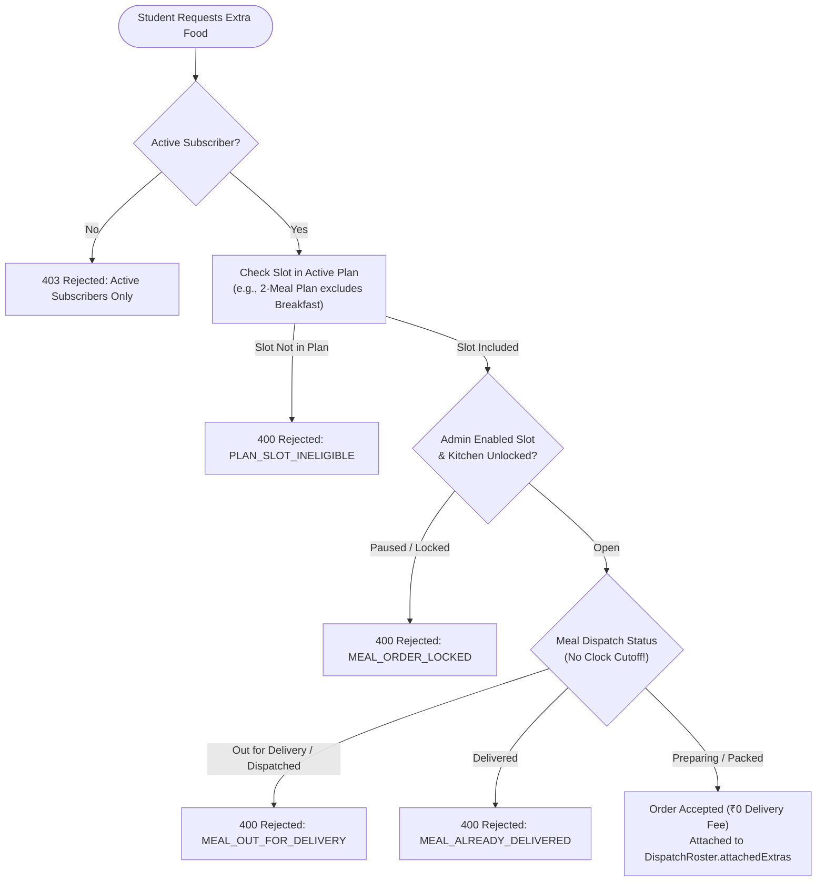
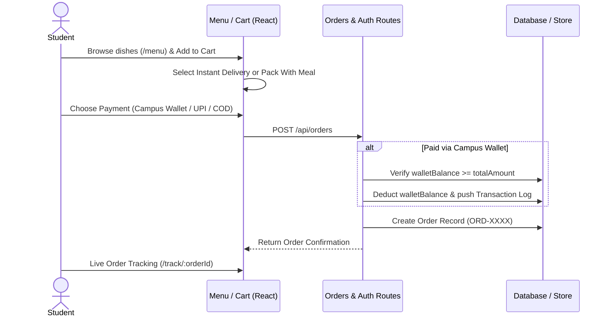
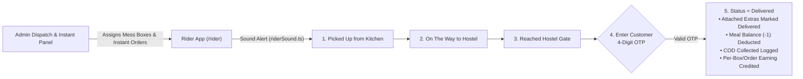

# Bitez Campus Mess & Food Delivery — Complete Project Workflows

This document maps out every end-to-end workflow across the **Bitez** platform, covering the **Student Portal**, **Admin Control Center**, **Delivery Rider App**, **Backend APIs**, and **Automated Policies**.

---

## 1. System Architecture Overview

### Core Portals & Routes
| Portal | Key Routes | Primary Components / Pages |
| :--- | :--- | :--- |
| **Customer / Student** | `/`, `/menu`, `/cart`, `/dashboard`, `/subscriptions`, `/timetable`, `/orders`, `/track/:orderId`, `/support` | `Home.tsx`, `Menu.tsx`, `Cart.tsx`, `Dashboard.tsx`, `Subscriptions.tsx`, `WeeklyTimetable.tsx`, `OrderTracking.tsx`, `MealLoadingScreen.tsx` |
| **Admin Mess & Kitchen** | `/admin`, `/admin/mess`, `/admin/instant`, `/admin/tiffin-plans` | `AdminPanel.tsx`, `InstantAdminPanel.tsx`, `AdminTiffinPlans.tsx`, `RiderEarningsReport.tsx`, `DeliveryRidersSuite.tsx` |
| **Delivery Rider** | `/rider`, `/rider-app` | `RiderApp.tsx`, `riderSound.ts` |

---

## 2. Subscription, Meal Balance & Skip Rollover Workflow

### Key Implementation Rules:
- **Automatic Meal Deduction**: When either the **Rider** verifies customer OTP (`PUT /api/rider/tasks/:id/status`) or the **Admin** updates dispatch status to `delivered` (`PUT /api/admin/dispatch/:id/status`), `remainingMeals` decrements by `1` (guarded by `mealDeducted: true` to prevent double deduction). If status is reverted from `delivered`, the meal is restored (`+1`).
- **Skip & Rollover Policy**: Skipping a meal does **not** credit cash to the wallet; instead, Admin approval rolls over `+1` saved meal to the student's `remainingMeals` balance (`admin.js` & `SkipMealModal.tsx`).
- **Real-Time Sync**: Displayed across `Dashboard.tsx` (Meal Balance Card), `Subscriptions.tsx`, and `AdminPanel.tsx`.

---

## 3. Daily 3-Slot Mess Operations & Dispatch Workflow

### Dynamic Meal Timings Management
- Admins can configure **Breakfast**, **Lunch**, and **Dinner** service hours, delivery windows, skip cutoffs, and enable/disable toggles directly from `AdminPanel.tsx` (backed by `mealTimingsHelper.js`).
- These live timings sync automatically across:
  - `Dashboard.tsx` (Current Shift Card & Countdown in IST)
  - `WeeklyTimetable.tsx`
  - `SkipMealModal.tsx` (Enforces slot-specific skip deadlines)
  - `OrderExtraModal.tsx` & `Cart.tsx`

---

## 4. "Extra Food With Meal Only" Policy Workflow

Extra items (Butter Rotis, Paneer Sides, Curd, Gulab Jamun, Lassi) are delivered for **₹0 delivery fee** packed directly inside the subscriber's daily tiffin box.

### Crucial Policy Rule:
- **Zero Clock-Time Closing**: Extra food ordering NEVER locks based on wall-clock time (`totalMins >= deliveryEndMins` was removed).
- It locks **strictly** when:
  1. The meal status transitions to **Out for Delivery** (`dispatched`, `out_for_delivery`, `on-the-way`, `picked-up`, `reached-gate`) or **Delivered**.
  2. The requested meal slot is not part of the student's active subscription plan.
  3. The admin pauses the slot or the kitchen locks the meal box.

---

## 5. Instant Food Ordering, Cart & Wallet Workflow

---

## 6. Rider App, OTP Delivery & Earnings Workflow

### Rider Earnings & Payouts (`riderEarningsHelper.js` & `RiderEarningsReport.tsx`)
- **Configurable Rates**: Admin sets custom Mess Per-Box delivery rates and Instant Order delivery rates.
- **Ledger Tracking**: Tracks deliveries per day, total earnings, customer tips, COD cash collected, and payout settlement requests (`POST /api/rider/payout-request`).

---

## 7. Branded Lunch Box Loading Experience

- `MealLoadingScreen.tsx` provides a unified, animated loading UI featuring a steaming **Hot Lunch Box (`♨️`)**, floating hostel delivery pills, and an animated **Delivery Scooter (`🛵`)** riding along the progress track.
- Active across `Dashboard.tsx`, `Subscriptions.tsx`, `WeeklyTimetable.tsx`, `OrderTracking.tsx`, and `Menu.tsx`.

